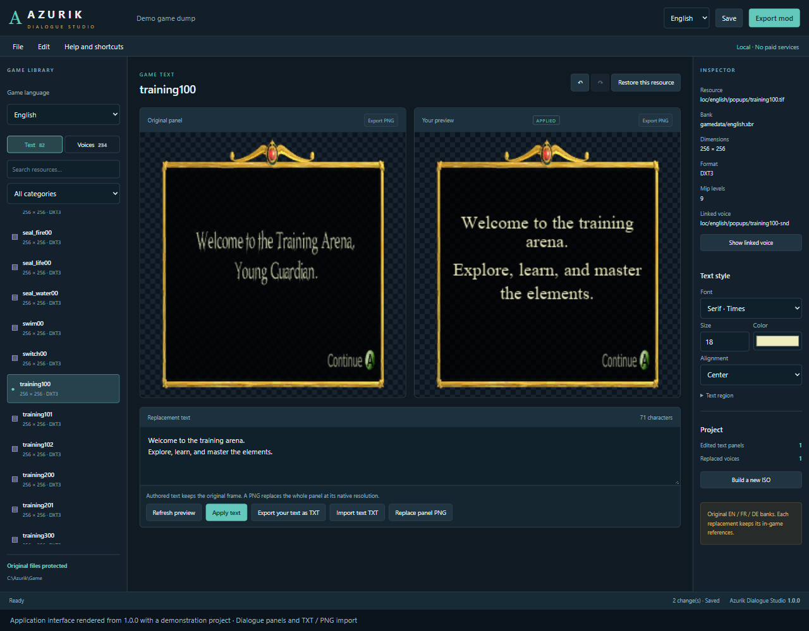
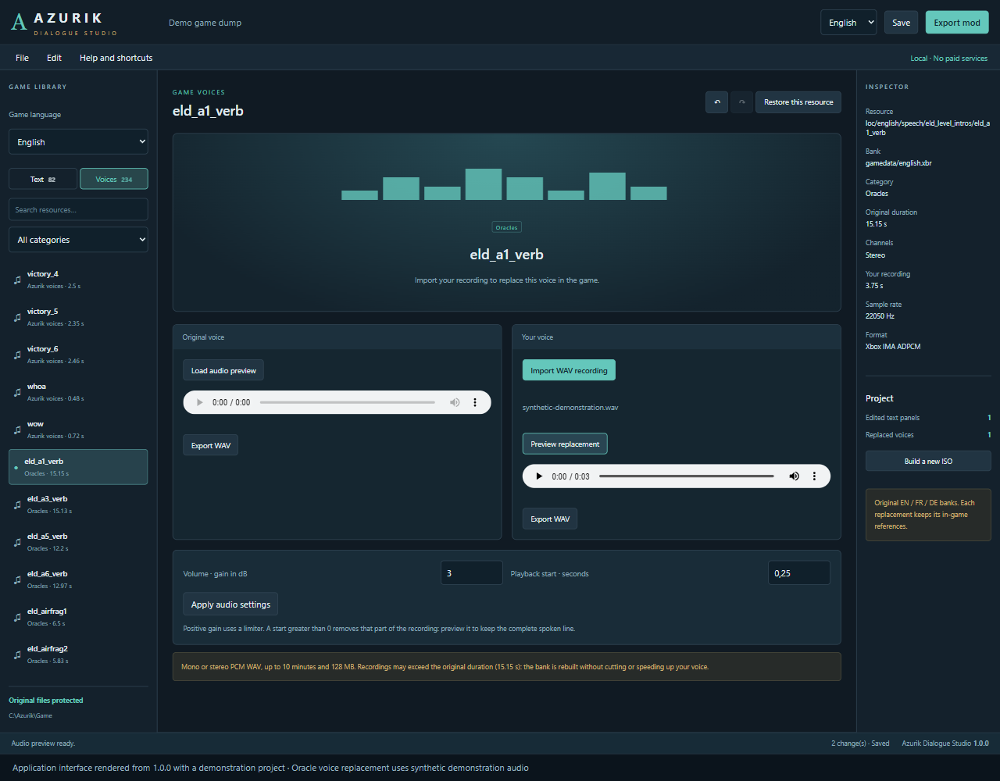

# Azurik Dialogue Studio — 1.0.0

Logiciel Windows pour **modifier les boîtes de dialogue existantes et remplacer les voix** d’Azurik: Rise of Perathia, édition européenne anglais/français/allemand.

[Télécharger la version officielle 1.0.0](https://github.com/Azurik-Modding-Hub/Azurik-Dialogue-Studio/releases/tag/v1.0.0) · [English](README.md)

Décompressez la distribution, puis lancez **`windows/Azurik Dialogue Studio.exe`**. Python n’est pas nécessaire pour utiliser l’exécutable. L’interface est disponible en français et en anglais ; la langue des ressources du jeu se choisit séparément.

## Ce que vous pouvez faire

- Ouvrir votre dossier de jeu extrait ou votre ISO/XISO Xbox locale.
- Parcourir **248 panneaux de dialogue** dans les trois banques de langue, comparer le panneau original et votre texte personnalisé, ajuster sa police, sa taille et son alignement.
- Importer un fichier **TXT UTF-8** pour remplacer un texte, ou un **PNG** pour remplacer le panneau entier. Le PNG est adapté à la résolution native ; le cadre et le bouton fournis dans votre image remplacent ceux du jeu.
- Conserver le cadre du panneau, son bouton de continuation et les niveaux de texture nécessaires au jeu.
- Préécouter les voix et remplacer un enregistrement, notamment les **49 voix d’oracles anglaises, 50 françaises et 50 allemandes**.
- Importer vos WAV PCM entiers **8/16/24/32 bits**, mono ou stéréo, avec une durée indépendante de la voix originale. La ressource est reconstruite pour garder votre enregistrement entier, sans couper ni accélérer la voix. Limites techniques : 10 minutes et 128 Mo par WAV.
- Régler le volume de la voix de −12 à +12 dB avec limiteur, et choisir explicitement le début à lire pour retirer un silence initial. Ces réglages restent à zéro par défaut.
- Enregistrer un panneau **PNG**, votre texte rédigé **TXT** ou une voix **WAV**, directement depuis le logiciel. Exporter toute la bibliothèque de textes ou de voix de la langue active dans des dossiers triés.
- Annuler, rétablir ou restaurer les originaux ; enregistrer un projet avec ses PNG et enregistrements importés.
- Exporter les banques modifiées dans un nouveau dossier ou construire **une nouvelle ISO vérifiée**, avec conservation des autres fichiers et de l’exécutable du jeu.

Tous les traitements fonctionnent localement. Aucun compte, abonnement, paiement, clonage vocal ou service d’IA n’est nécessaire. Le jeu et ses ressources ne sont pas inclus dans la distribution.

## Illustrations de l’interface

Interface de la version 1.0.0 rendue avec un projet de démonstration isolé.
L’exemple de voix utilise un son synthétique. Ces images illustrent les outils
d’édition ; la validation du résultat dans le jeu reste distincte.

EDIT : You need to clear the cache for the changes you make to take effect ! Don’t worry, this won’t affect your save files in any way!

## Première utilisation

1. Choisissez **Fichier → Ouvrir un dump** ou **Ouvrir une ISO**.
2. Sélectionnez la langue du jeu, puis **Textes** ou **Voix**.
3. Appliquez votre texte ou importez votre enregistrement WAV.
4. Enregistrez votre projet, puis choisissez **Exporter le mod** ou **Construire une nouvelle ISO**.

Le [guide d’utilisation](GUIDE.md) détaille les oracles, les raccourcis et les exports.

## Périmètre de cette version

Les textes originaux sont des **images**, et non des phrases enregistrées en texte brut : le logiciel affiche l’image originale et vous laisse écrire votre remplacement. Il ne fait pas d’OCR. Cette version remplace des ressources existantes ; elle n’ajoute pas de nouvelles répliques, de déclencheurs, d’événements ou de pistes aux cinématiques Bink.

Les formats, la conservation des octets hors modification et la reconstruction ISO sont testés. Le codec audio a également été comparé à un décodeur indépendant. **Le résultat en jeu dans Xemu reste à tester** ; la validation d’un fichier exporté ne constitue pas une validation du jeu complet.

Windows doit disposer de **Microsoft Edge WebView2 Runtime** pour afficher la fenêtre. Le logiciel n’installe rien automatiquement si ce composant manque.

Le logiciel protège les fichiers source et ne modifie pas les sauvegardes du jeu. Il ne nettoie aucun cache automatiquement. Si Xemu affiche encore une ancienne modification, consultez la section cache du [guide](GUIDE.md).

Le projet est distinct d’Azurik Level Studio et du projet de décompilation manuelle Azurik-Decomp. Aucun fichier de ces projets n’est modifié par son utilisation.

## Textes inutilisés et événements dans les niveaux

Un panneau disponible dans les banques n’apparaît pas automatiquement dans le jeu.
Les événements natifs relient une zone ou une action à un contrôleur de dialogue,
puis au panneau et à sa voix. Par exemple, `training100` appartient au tutoriel
et la ressource `e6daylight00` contient le message des miroirs.

L’ajout de nouveaux déclencheurs et leur placement dans Azurik Level Studio
reste à développer et à valider en jeu. Dialogue Studio remplace les ressources
existantes ; il ne crée pas ces événements. Une ISO déjà modifiée par Level Studio
peut servir de source à l’export de dialogues : ses niveaux et son exécutable
sont conservés.

[Vérifications réalisées](VALIDATION.md) · [Événements et lien avec Level Studio](EVENTS.md)

## Sources et licence

Code du logiciel sous [licence MIT](LICENSE). Les outils ISO repris d’Azurik Level Studio conservent leur [licence et leurs attributions](THIRD_PARTY_LICENSES.md).

Le dépôt et les distributions doivent rester exempts de banques du jeu, d’ISO, de voix originales, d’enregistrements personnels, de projets utilisateurs et de fichiers privés de recherche.
